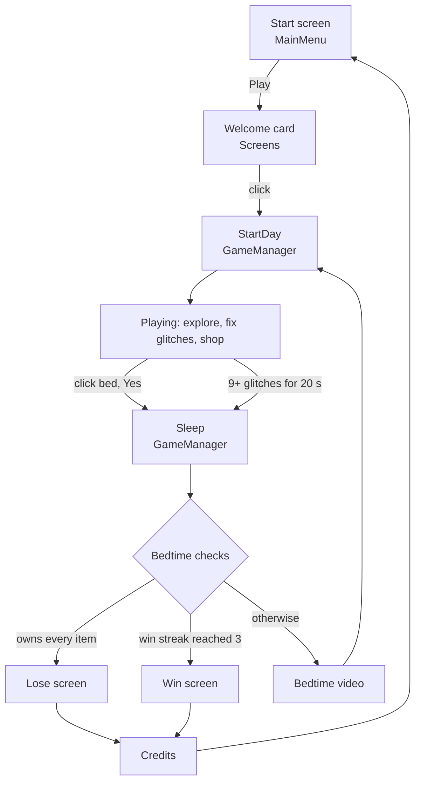
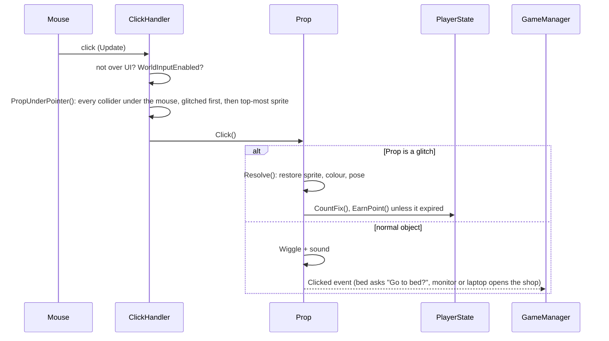

# While Stocks Last! Codebase Guide (v1.1)

**A bootcamp for programmers who know Unreal but not Unity.** It covers how the game runs today, which file does what, and where the weak spots are. Read it top to bottom once, then use it as a map.

---

## 1. Unity in Unreal terms

| Unreal | Unity | In this project |
|---|---|---|
| Level / Map | **Scene** (`.unity` file) | One scene: `Assets/Scenes/Game.unity` |
| Actor | **GameObject** | Every object in the room, every UI box |
| ActorComponent | **MonoBehaviour** (a C# script on a GameObject) | `Prop`, `Shop`, `GameManager`… |
| Blueprint class | **Prefab** | Not used: everything is generated by code (see section 3) |
| `UPROPERTY(EditAnywhere)` | A `public` field, or one marked `[SerializeField]` | Shows in the **Inspector**, editable without code |
| `BeginPlay` / `Tick` | `Awake`/`Start` / `Update` (`LateUpdate` runs after all `Update`s) | |
| Timers / latent actions | **Coroutines** (`IEnumerator` + `yield return`) | Day flow, fades, flyers, mid-day spawns |
| GameMode | Just a script: `GameManager` | The state machine |
| GameInstance / static state | A `static class` | `PlayerState` |
| Data Asset | ScriptableObject | Not used yet (worth using in v2) |
| Editor Utility Widget | **Editor script** (`[MenuItem]`, `EditorWindow`) | The **Cozy Horror** menu |
| Sprite in Paper2D | `SpriteRenderer` | All art |
| UMG | **uGUI** (`Canvas`, `Image`, `Text`, `Button`) | All menus and the HUD |

Two Unity habits that differ from Unreal:
- **Scripts don't find each other automatically.** References are fields filled in the Inspector, and here the scene builder fills them.
- **Only `Assets/` is the game.** `Library/`, `Temp/` and `Builds/` are generated; never edit them.

---

## 2. Folder map

```
Assets/
  Art/Source/        Hand-drawn PSDs (rooms, props, UI, screens), imported directly by Unity
  Art/Sprites/UI/    A few sprites the builder generates (arrow, vignette, glow, cursor)
  Audio/             Music (MUS_Day_01-04) and sound effects (SFX_*)
  Scenes/Game.unity  THE scene, generated by the builder: don't hand-edit
  Scripts/           Runtime code, the game itself (26 files, about 2,600 lines)
  Editor/            Editor-only tools: scene builder, builds, import settings (5 files, about 1,600 lines)
  StreamingAssets/   VID_Transition.mp4 (the bedtime video)
Builds/              Player builds and zips (not in git)
V1.1_GUIDELINES/     Art/sound rules and this guide
DESIGN.md            Rules and every tuning number
ANOMALIES.md         Generated list of what can glitch and how
```

---

## 3. The big idea: the scene is generated

There are **no hand-placed objects and no prefabs**. Clicking **Cozy Horror ▸ Rebuild Game Scene** runs `CozyBuilder.Build()`, which:

1. Wipes and recreates `Game.unity`.
2. Places the room PSDs. Each Photoshop layer becomes a GameObject with a sprite.
3. Turns layers into clickable objects (`Prop`), using name tables written in the builder (for example `"Layer 10"` → `"Delivery Truck"`).
4. Places the 9 shop items and 7 delivery boxes, pairs normal and glitch art, merges multi-part objects, and turns some layers into scenery.
5. Builds **the whole UI in code**: shop window, flyer, HUD, pause menu, dialogs, screens.
6. Wires every reference: who talks to whom.
7. Measures every sprite to decide which glitches are visible on it, writes `ANOMALIES.md`, and saves the scene.

**Why it was done this way:** it let everything be built and rebuilt from the command line, without the editor open, and it keeps art changes painless (save the PSD, rebuild).
**The cost:** any manual edit in the Unity editor is lost on the next rebuild, and the builder is one 1,181-line file. This is the main refactor question for v2 (see section 9).

---

## 4. How a run flows



**`GameManager.StartDay()`** runs each morning and does, in order:
1. `PlayerState.StartNextDay()`: Day +1, today's counters reset.
2. Camera jumps to the bedroom; the shop restocks.
3. `AnomalyDirector.OnDayStart(day)` spawns the morning glitches.
4. Day music; the atmosphere clock starts; fade in.
5. The flyer timer, the "DAY n" banner, and the computer pings start.

**`GameManager.Sleep()`** runs at bedtime: stops everything, runs `PlayerState.EndDay()` (the win-streak bookkeeping), checks lose then win, plays the video, then calls `StartDay()` again.

`GameManager` has 4 phases: `Title`, `Playing`, `Busy` (fades, transitions) and `Ended`. Two properties gate almost everything:
- `WorldInputEnabled`: clicks may reach the room (no shop, bed dialog or pause open, and not mid-transition).
- `CanPause`: we're in a day.

---

## 5. How a click flows



Clicking empty space shows a small "…" puff (`ClickPuff`).

---

## 6. Every runtime script

### Core: the game's backbone
| File | Lines | What it does |
|---|---|---|
| `GameManager.cs` | 182 | State machine: start, day flow, bed, endings, computer pings. Holds references to every other system. |
| `PlayerState.cs` | 65 | **Static** run data: day, points (spendable), points earned (lifetime), purchases today, fixes today, win streak, owned items. No save file. |
| `RoomCamera.cs` | 140 | Shows one room at a time, letterboxed to its shape; arrows and A/D move between rooms (pan or fade). |
| `Atmosphere.cs` | 187 | Time of day (4 lighting steps over 120 s), the creep vignette, music detune, and the creep consequences: flicker, vanishing objects, forced sleep. |
| `MusicPlayer.cs` | 63 | Day tracks 1–4, then random tracks; detunes with creep. |
| `Sfx.cs` | 37 | A pool of audio sources so overlapping sounds don't cut each other off. |
| `GameInput.cs` | 48 | Wraps Unity's Input System: clicks, arrows, pause, debug keys. |

### Interaction: the room
| File | Lines | What it does |
|---|---|---|
| `Prop.cs` | 230 | **The most important script.** Anything clickable. Hover grow, wiggle, pop; becoming a glitch (sprite swap, tilt, shift, grow, shrink, red tint, vanish); fixing; cooldown and bounty expiry; the open/closed toggle (shower curtain). It owns its transform: never move a Prop from other code. |
| `ClickHandler.cs` | 71 | Finds the Prop under the mouse each frame; hover cursor; click dispatch. |

### Anomalies
| File | Lines | What it does |
|---|---|---|
| `AnomalyDirector.cs` | 169 | Decides **when and where** glitches happen: morning batch (3, 5, 7, 9…, max 10 at once), mid-day surprises in rooms you're not in, "calls" (a glitch twitches and plays its sound), weighted picking (drawn art favoured), vanish spawns for creep. |

### Items: the shop
| File | Lines | What it does |
|---|---|---|
| `Shop.cs` | 173 | The BuyMe shop: stock, pages, prices by card slot (×2 from Day 5, ×3 from Day 11), buying, delivery boxes, items popping in after closing. |
| `ShopItem.cs` | 37 | Marks a room object as buyable (id, name, icon); hidden until owned. |

### UI
| File | Lines | What it does |
|---|---|---|
| `Screens.cs` | 121 | Full-screen pages (welcome, win, lose, credits), the black fade, the day banner, the bedtime video. |
| `FlyerPopup.cs` | 146 | The BuyMe flyer: when it shows, its glitch version, opening the shop from Day 4, auto-hide. |
| `HouseVoice.cs` | 137 | Captions from the TV, radio, laptop and smart speaker. **All lines are in this file.** |
| `ShopCard.cs` | 41 | One product card in the shop, including the red "NOW x!" price sticker. |
| `PauseMenu.cs` | 79 | Esc menu: Resume, What to do?, Credits, Quit. |
| `MainMenu.cs` | 27 | Start screen buttons. |
| `Hud.cs` | 31 | **Temporary** DAY / POINTS bar. |
| `ConfirmDialog.cs`, `Toast.cs`, `RoomLabel.cs`, `ClickPuff.cs` | 33–44 each | "Go to bed?", short messages ("CAN'T AFFORD"), room name, the miss puff. |
| `UIAnim.cs` | 62 | Small tween helpers (fade, pop, slide, shake) using unscaled time, so they work while paused. |

### Debug
| File | Lines | What it does |
|---|---|---|
| `DebugTools.cs` | 28 | Keys 1–4 in dev builds: +5 points, spawn a glitch, show the flyer, state readout. |
| `Playtest.cs` | 356 | An **automated play-through** (41 checks) that runs when a dev build starts with `COZY_PLAYTEST=1`. It covers menus, shop, glitches, curtain, creep, price hikes, win and lose, memory, and objects staying in place. It writes `results.txt` and screenshots. |

---

## 7. Editor tools (the **Cozy Horror** menu)

| File | Lines | What it does |
|---|---|---|
| `CozyBuilder.cs` | 1,181 | The scene generator (section 3). Sections: **data** (name tables, shop item placements), **world** (rooms, props, items, boxes, merges, scenery), **UI** (every screen built in code), **helpers**, **anomaly visibility** (sprite measuring → `ANOMALIES.md`). |
| `CozyBuild.cs` | 56 | Player builds: Windows (dev and release), Mac (Intel), WebGL. |
| `CozyImport.cs` | 89 | Import settings: layered PSD import, click shapes from sprites, audio preload. |
| `CozyInspect.cs` | 257 | Diagnostics used during development: dump the scene, export layer sheets, render rooms to PNG, and so on. |
| `CozyPlaytest.cs` | 12 | An old attempt at running the playtest in the editor. **Unused**: playtests run in dev builds instead. |

**Command-line use:** every tool can run without opening Unity:

```
Unity.exe -batchmode -quit -projectPath <project> -executeMethod CozyBuilder.Build -logFile build.log
```

This fails if the project is already open in the Unity editor, so close Unity first.

---

## 8. Where the numbers live

Every tuning value is a public field, editable in the Inspector on the generated scene, and listed in `DESIGN.md`. **But the builder recreates the scene**, so an Inspector change survives only until the next rebuild. To change one permanently, change the **default value in the script**, such as `public int maxActive = 10;` in `AnomalyDirector.cs`.

| What | Where |
|---|---|
| Starting points, win rules | `GameManager` |
| Glitches per day, max at once, mid-day surprises, drawn-art bias | `AnomalyDirector` |
| Bounty expiry, cooldown | `Prop` |
| Day length, creep thresholds | `Atmosphere` |
| Prices, price hikes, purchases per day | `Shop` |
| Flyer timings and chances | `FlyerPopup` |
| House voice lines | `HouseVoice` |

---

## 9. Weak spots: what to refactor, delete or remake

Honest notes for planning v2, roughly in order of impact.

1. **The builder is a monolith.** It's one 1,181-line file mixing data tables, world setup and all UI construction.
   - **Option A:** split it into several files (`RoomBuilder`, `UIBuilder`, `CatalogLoader`).
   - **Option B:** move the UI to **prefabs** (Unity's Blueprints), built and tweaked visually in the editor, and keep the builder for the rooms only. This is the biggest decision for v2.
2. **Hard-coded layer names.** Tables like `"Layer 10"` → `"Delivery Truck"` exist because the PSDs had unnamed layers. The v1.1 asset guidelines replace them with naming rules the builder can read automatically.
3. **Content lives in code.** Shop items, prices, house voice lines and flyer timings are all in C#. For 50 products and a writer, they belong in data: CSV sheets or ScriptableObjects.
4. **`PlayerState` is static, with no save file.** That's fine for a jam, but achievements, a glitch collection and speedrun records need a save system, which means making state saveable.
5. **`GameManager` knows everyone.** References are wired by the builder, and many systems call `GameManager.Instance`. Workable at this size, but story events, saves and achievements will add more cross-talk. An event system (for example "AnomalyFixed", "ItemBought", "DayStarted") would keep systems independent.
6. **Placeholder UI.** The HUD, toasts and dialogs are plain boxes built in code, and need real UI art and layout.
7. **Safe to delete now:** `CozyPlaytest.cs` (unused) and most of `CozyInspect.cs` (one-off diagnostics; keep `Snapshots` and `ExportLayerSheets`).
8. **Keep:** `Prop`, `AnomalyDirector`, the click logic, `RoomCamera`, `UIAnim`, `Sfx` and the automated playtest. These are solid and already tested.

---

## 10. Hands-on exercises (about an hour)

1. **Read along a click.** Open `ClickHandler.cs` → `PropUnderPointer()`, then `Prop.cs` → `Click()`. Follow one glitch fix from mouse to points.
2. **Change a number.** In `AnomalyDirector.cs`, change `maxActive` from 10 to 3. Run **Cozy Horror ▸ Rebuild Game Scene**, press Play, and use debug key **2** to spawn glitches. You'll see it stop at 3. Change it back.
3. **Add a line.** In `HouseVoice.cs`, add a line to the Day 1–2 ads, rebuild, and wait for the TV to say it.
4. **Find a link.** Search `CozyBuilder.cs` for `bedDialog` and see how the builder creates the "Go to bed?" box and hands it to `GameManager`. That's the pattern for every UI piece.
5. **Break something safely.** Rename a layer in a copy of a room PSD, rebuild, and read the error in the Console. That's why the naming rules exist.

Undo experiments with `git checkout -- <file>`, or by discarding the change in GitHub Desktop.
